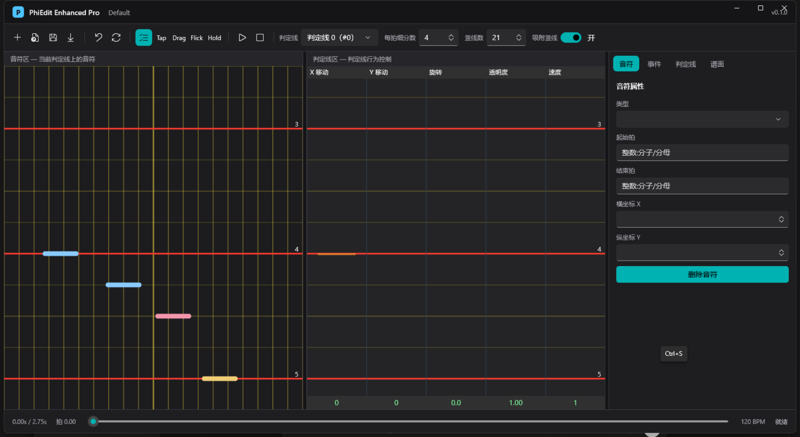

# PhiEdit Enhanced Pro

基于 [Re:PhiEdit Next](https://github.com/kclg-YSJ/rpe-next)（PolyForm-Noncommercial-1.0.0）的**逻辑**重新实现的 Phigros 制谱器。
新程序完全抛弃原有 Electron/浏览器内核，改用 **C# + WinUI 3 (Windows App SDK)** 构建原生 Windows 桌面应用。

- 目标平台：Windows 10 1809 及以上 / Windows 11（x64 为主，保留 x86 / ARM64）
- 不使用任何浏览器套壳，不依赖 WebView2、Chromium 或 Node 运行时
- 界面为 Fluent 风格，全中文文案，不含 Emoji（图标统一使用 Segoe Fluent Icons 字形）
- 原始素材（曲绘、音效、噪域皮肤、Shader）仍以 RPE/PEZ 资源形式兼容

> 参考源码放在 `reference/`（已从 Git 版本管理中排除）。该目录仅用于**逻辑参考**，
> 其中的 JavaScript 代码不会被编译进新程序，也不会被复制到 `src/`。

---

## 当前版本：v1.3.0_BETA1

版本号格式为 `[x].[y].[z]_BETA[i]`：`x` 只有用户明确要求时才变更；`y` 用于新增大功能（如实时预览）；`z` 用于大功能的小功能追加（如把实时预览嵌入编辑区）；`i` 用于缺陷修复。本版本新增低延迟音频播放：背景音乐与音符音效分层混音，按判定线独立音量/静音/独奏，命中音按 44.1kHz PCM 预解码并在 WASAPI 10ms 缓冲内按采样点调度。包含示例 PEZ、PEZ 导入、独立实时预览、整谱面状态计算、资源包与背景还原；此前已修复判定线透明度、资源包贴图重复染色与低 alpha 判定线上音符消失等问题，并加固预览运行时与缓存。

---

## 目录结构

```
PhiEdit-Enhanced-Pro/
├─ PhiEdit.sln                    解决方案
├─ Directory.Build.props          全局编译属性
├─ docs/
│  ├─ ARCHITECTURE.md             架构说明
│  └─ FEATURE-PARITY.md           与原版的功能对照表
├─ reference/                     原始 RPE Next 源码（仅参考，不入库）
└─ src/
   ├─ PhiEdit.Core/               领域模型与编辑逻辑（纯 .NET，不含 UI 依赖）
   ├─ PhiEdit.App/                WinUI 3 应用层
   └─ PhiEdit.Core.Tests/         核心逻辑单元测试
```

## 构建与运行

本机环境（已验证）：

| 组件 | 版本 |
| --- | --- |
| .NET SDK | 10.0.403（目标框架 net8.0） |
| Windows App SDK | 1.8.260209005 |
| Win2D (`Microsoft.Graphics.Win2D`) | 1.4.0 |
| Visual Studio | 2026 (18.x) Community |

```powershell
# 还原与构建
dotnet build PhiEdit.sln -c Debug

# 运行
dotnet run --project src/PhiEdit.App/PhiEdit.App.csproj

# 单元测试
dotnet test src/PhiEdit.Core.Tests/PhiEdit.Core.Tests.csproj
```

> **注意**：Windows App SDK 的 XAML 编译器在控制台代码页非 UTF-8 时会静默失败。
> 如果在 cmd/PowerShell 里看到 `MSB3073 ... XamlCompiler.exe 已退出，代码为 1` 且没有任何错误信息，
> 先执行 `chcp 65001` 再构建即可。仓库提供了 `build.cmd` 自动完成该设置。
> Visual Studio 内部构建不受此影响。

## 音符资源包（贴图）

程序支持 RPE 的**音符资源包**（Note Skin）机制：资源包是一个 ZIP，内含 `info.yml` 清单、
9 张必备贴图（`click/drag/flick/hold` 的普通与命中高亮版 + `hit_fx`）以及可选音效。

- 内置资源包：随程序分发的 `高仿官皮新版`（`src/PhiEdit.App/Assets/NoteSkins/`），
  启动即加载并生效，音符按贴图绘制（含 Hold 的头/身/尾三段图集）。
- 导入：工具栏「设置」→ 子页面 →「导入资源包」，选中 ZIP 即可导入并立即应用。
- 清单字段：`name` / `author` / `description` / `hitFx` / `holdAtlas` / `holdAtlasMH` /
  `hitFxDuration` / `hitFxScale` / `hitFxRotate` / `hitFxTinted` / `hideParticles` /
  `holdKeepHead` / `holdRepeat` / `holdCompact` / `colorPerfect` / `colorGood`。
- 设置子页面为模态：遮罩覆盖主窗口，关闭前无法操作主页面，尺寸固定并居中。

## 界面结构

主窗口从正中间分成两个编辑区，与原版 RPE 的编辑观感一致：



```
┌──────────────── 标题栏 ────────────────┐
├──────────────── 工具栏 ─────────────────┤
│ 音符区（当前判定线的音符）│ 判定线区（判定线行为控制）│ 属性面板 │
├──────────────── 底栏（时间 / 拍 / 进度）─┤
└────────────────────────────────────────┘
```

### 网格绘制规则（与原版一致）

- **整拍线**：红色、加粗，右侧标注拍号。
- **横线（时间细分）**：绿色细线，数量由「每拍细分数」决定——相邻两根整拍线之间的细线数即为几分之几拍。
- **竖线（音符横坐标网格）**：黄色细线，数量可调；**竖线数量为奇数时，居中的那条竖线会被加粗**。

### 与原版一致的操作习惯

| 操作 | 行为 |
| --- | --- |
| 滚轮 | 一格 = 一个细分单位；**向下滚 = 拍号变小**（回看更早的拍），与原版一致 |
| Ctrl+滚轮 | 纵向缩放（光标处的拍保持不动） |
| 滚轮位置 | 只要指针在编辑区内就滚动时间轴，与当前焦点在哪个控件无关 |
| 点击音符 / 事件 | 自动切换属性页签并改名为「音符」/「事件」；无选中时页签显示「编辑」且不可选 |
| Ctrl+单击 | 加选 / 取消加选（不进入拖动） |
| Shift+拖动 | 框选（在音符区与判定线区都可用），Shift 为追加模式 |
| Ctrl+C / X / V | 复制 / 剪切 / 粘贴（按剪贴板最早拍对齐到当前位置） |
| Ctrl+M | 镜像（以判定线为轴） |
| Ctrl+A | 全选当前判定线的音符 |
| Delete | 删除选中对象 |

### 时间轴方向

时间轴**自下而上流逝**（与原版 RPE 一致）：拍号越大越靠上，越靠下拍号越小。

- **判定线（播放头）**：粗灰线，固定在音符区与判定线区的最下方，代表当前播放位置。
- 网格线（整拍线、黄色横线、黄色竖线）只绘制在判定线以上，到判定线处断开。
- 音符则一直绘制到离开可视区为止，因此判定线下方仍能看到刚刚经过的音符。
- 两侧编辑区共用同一时间轴，滚动与缩放**始终同步**；向下滚动时内容向下移动。
- 纵向位置只有一个真源（判定线所在的拍）：滚轮、缩放、底部进度条、播放推进都只改它，
  变化后立即广播给两侧画布与底栏，因此不存在某一侧滞后的情况。
- 拍号不会出现负值：判定线处的拍恒不小于 0，判定线以下的窄带不绘制任何网格与拍号。

## 当前阶段已实现的功能

- 音符区：单击放置音符（Tap / Drag / Flick / Hold）、单击选中、拖动移动、按细分线与竖线吸附
- 判定线区：按轨道（X 移动 / Y 移动 / 旋转 / 透明度 / 速度）分栏展示事件，双击新建事件，拖动改时间
- 属性面板：音符属性、事件属性、判定线列表、谱面信息与 BPM
- 播放时钟：空格播放/暂停，底栏进度条拖动定位，播放头自动跟随滚动
- 撤销 / 重做（Ctrl+Z / Ctrl+Y）、删除（Delete）
- RPE JSON 谱面的读写与打开 / 保存 / 导出
- 可扩展点：`IEditorExtension` / `IChartSerializer` / `IToolProvider`

后续功能规划见 [docs/FEATURE-PARITY.md](docs/FEATURE-PARITY.md)。

## 许可

本仓库代码遵循与衍生项目一致的 **PolyForm-Noncommercial-1.0.0** 许可。
`reference/` 下的原始源码版权归原作者所有，未纳入版本管理。
